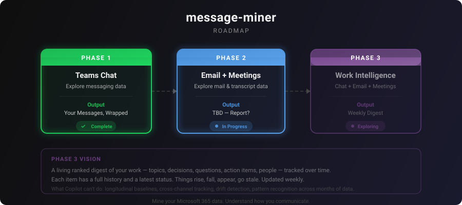

# message-miner

> **Note:** This project is no longer under active development. The Teams chat pipeline (Phase 1) is complete; the email pipeline in `mail-miner/` (Phase 2) was left in progress, and Phase 3 was never started.



A Spotify Wrapped–style report for your Microsoft Teams chat history. See your top people, topics, emoji, response patterns, and more — all from your own data. Results are stored only on your machine; the LLM steps send message text to the OpenAI API (see [Privacy](#privacy)).

---

## Prerequisites

Before you can run message-miner, you need the following installed on your machine.

### Python 3.10 or higher

Check if you already have it:

```bash
python --version
```

If you see `Python 3.10.x` or higher, you're good. If not, download and install it from [python.org](https://www.python.org/downloads/). During installation on Windows, check the box that says **"Add Python to PATH"**.

### Git

Check if you already have it:

```bash
git --version
```

If not, download it from [git-scm.com](https://git-scm.com/downloads). On Mac, running `git --version` will prompt you to install it automatically.

### An OpenAI API key

The pipeline uses OpenAI for conversation segmentation, topic classification, summarization, and action item extraction. You'll need a key with a few dollars of credit.

---

## Get Started

**1. Clone the repo and enter the directory**

```bash
git clone https://github.com/plot-hole/message-miner.git
cd message-miner
```

**2. Install dependencies**

```bash
pip install -r requirements.txt
python -m spacy download en_core_web_sm
```

**3. Add your credentials**

Copy `.env.example` to `.env` and fill in your values:

```
AZURE_TENANT_ID=...
AZURE_CLIENT_ID=...
OPENAI_API_KEY=sk-...
```

If your OpenAI key is already saved as an environment variable on your computer called `OPENAI_API_KEY`, you can skip this step.

The Azure values come from your own app registration — see [Authentication](#authentication).

**4. Run the pipeline**

```bash
python run_all.py
```

A browser window will open for Microsoft sign-in. You'll be prompted to choose how far back the analysis goes. Once you confirm, a time and cost estimate will be shown before any paid steps run.

**5. Open your report**

When the pipeline finishes, your report will open automatically in a browser. You can also find it at `outputs/12_wrapped/wrapped.html`.

---

## What You Get

A scrollable, dark-themed HTML report with 10 sections:

| Section | What it shows |
|---------|--------------|
| **The Headline** | Total messages, words, conversations, people — and how many novels you've written |
| **Your Top People** | Who you talk to most, your #1 person, send/receive ratios, new connections |
| **Your Calendar** | Day × hour heatmap, peak day, peak hour, after-hours percentage, monthly trends |
| **Your Topics** | LLM-classified topic taxonomy, topic trends over time, who you discuss what with |
| **Your Conversations** | Conversation count, initiation rate, longest streak, longest silence |
| **Your Response Patterns** | Your median response time, fastest/slowest responders, who you prioritize |
| **Your Emoji Game** | Top emoji, signature emoji, emoji density, most-reacted message |
| **Your Words** | Vocabulary size, reading level, distinctive words, top entities, question habits |
| **Your Conversations, Classified** | Functional breakdown, depth scores, recent decisions, questions, open action items |
| **Your Year in Review** | An LLM-written personalized narrative about your communication year |

---

## How It Works

The pipeline runs 12 scripts in sequence. `run_all.py` handles the order, shows progress, and skips steps that have already completed.

| Step | What it does | Time | Cost |
|------|-------------|------|------|
| 01 — Connect | Authenticate via browser sign-in | 30s | — |
| 02 — Extract | Download your Teams messages | 2–10 min | — |
| 03 — Clean | Normalize message text | 30s | — |
| 04 — Edge Cases | Flag bots, cards, emoji-only messages | 30s | — |
| 05 — Enrich | Add response times, word counts | 1 min | — |
| 07 — Segment | Group messages into conversations (new conversation after a 1-day gap) | 30s | — |
| 09 — Emoji | Extract emoji and reactions | 1 min | — |
| 11 — Summarize | Summarize each conversation (LLM) | 10–20 min | ~$1.50 |
| 11b — NLP Features | Vocabulary, readability, entities | 5–15 min | — |
| 11c — Classify | Function, depth, decisions, action items (LLM) | 10–15 min | ~$1.50 |
| 08b — Topics | Generate topic taxonomy and classify (LLM) | 10–15 min | ~$0.25 |
| 12 — Wrapped | Compute metrics and render the report | 30s | ~$0.01 |

If the pipeline is interrupted, just run `python run_all.py` again — it resumes where it left off.

---

## Authentication

You need an Azure app registration in your Microsoft 365 tenant: a public client app with `http://localhost` as a redirect URI and the delegated Microsoft Graph permissions `Chat.Read`, `Mail.Read`, and `User.Read`. Put its tenant ID and client ID in `.env`. When you sign in, the pipeline only accesses chats and mail that *you* have access to. Depending on your organization's settings, an admin may need to approve the app.

Sign-in tokens are cached locally in `.token_cache.json` and refresh silently for ~90 days.

---

## Privacy

Everything the pipeline produces is stored in `outputs/` on your machine, and `outputs/` is gitignored.

The LLM steps — 11 (Summarize), 11c (Classify), 08b (Topics), and the year-in-review narrative in 12 (Wrapped) — send message text to the OpenAI API for processing, so that text is subject to OpenAI's API data policies. The other steps run entirely on your machine.

The final report contains personal messaging data including names, statistics, conversation summaries, and quoted messages. **Review before sharing.**

---

## Running Individual Steps

If you need to re-run a specific step:

```bash
python message_miner/05_enrich.py           # Run one step
python message_miner/11_summarize.py --force # Re-run from scratch (ignore cache)
```

---

## Troubleshooting

**"spaCy model not found"** — Run `python -m spacy download en_core_web_sm`.

**"OPENAI_API_KEY not set"** — Make sure your `.env` file is in the project root folder (same level as `run_all.py`) and contains `OPENAI_API_KEY=sk-...`.

**"python is not recognized" (Windows)** — Python wasn't added to your PATH during installation. Reinstall Python and check the "Add Python to PATH" box, or search for "Edit the system environment variables" in Windows and add the Python folder manually.

**"pip is not recognized"** — Try `python -m pip install -r requirements.txt` instead.

**Browser doesn't open for sign-in** — Make sure `http://localhost` is set as a redirect URI on the Azure app registration.

**SSL certificate errors on a corporate network** — If your network inspects HTTPS traffic, have Python trust your organization's root certificate (for example, by setting `SSL_CERT_FILE` and `REQUESTS_CA_BUNDLE` to its path) rather than disabling certificate verification.

**LLM script errors** — All LLM scripts are resume-safe. Re-run the same command and it continues from cache.

**Charts show no data** — Re-run `python message_miner/12_wrapped.py` to regenerate the report.

---

## Project Structure

```
message-miner/
├── run_all.py                           # One-command pipeline runner
├── .env.example                         # Template for Azure + OpenAI credentials
├── requirements.txt
├── docs/
│   └── roadmap.svg
├── message_miner/
│   ├── 01_connect.py
│   ├── 02_extract.py
│   ├── 03_clean.py
│   ├── 04_edge_cases.py
│   ├── 05_enrich.py
│   ├── 07_segment.py
│   ├── 08b_topics_llm.py
│   ├── 09_emoji.py
│   ├── 11_summarize.py
│   ├── 11b_nlp_features.py
│   ├── 11c_classify.py
│   ├── 12_wrapped.py
│   ├── templates/
│   │   └── wrapped_template.html
│   └── helpers/
│       ├── auth.py
│       └── graph.py
├── mail-miner/                          # Email pipeline (Phase 2, in progress)
└── outputs/                             # Pipeline outputs, stored locally (gitignored)
```
